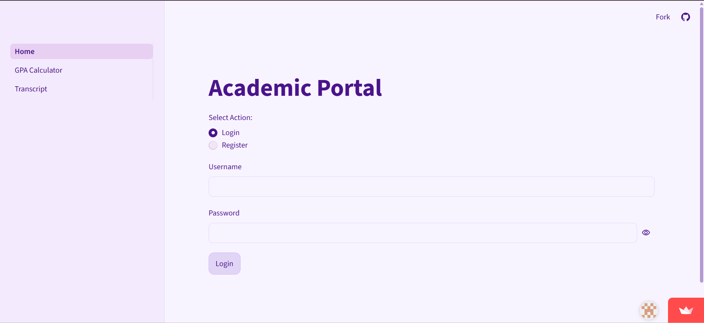
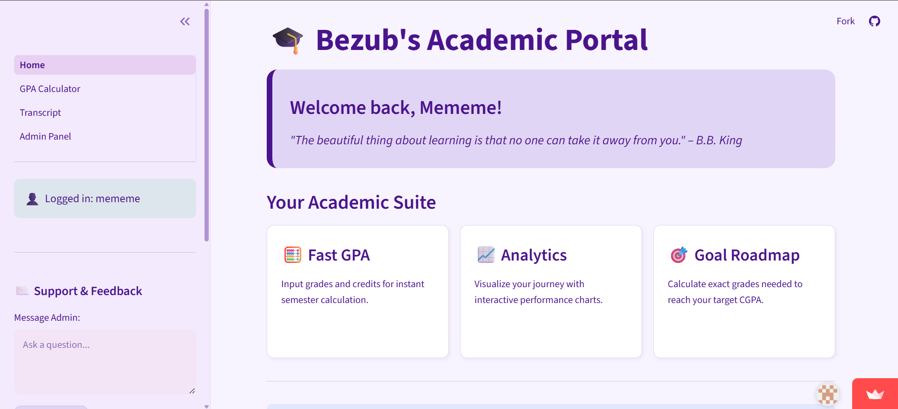
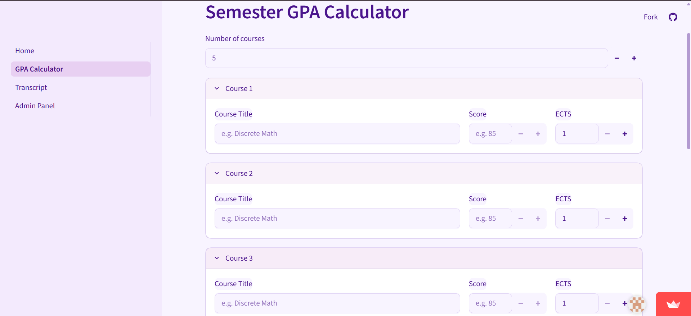
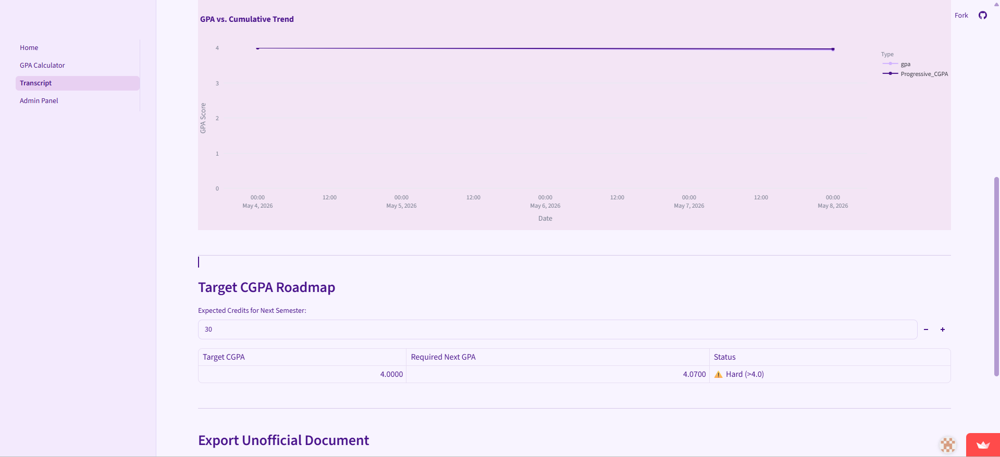

# Bezub Academic Portal (Version 1)

**Live App:** [Open Here](https://bezub-academic-system.streamlit.app/)

A strategic GPA management system built with **Python**, **Streamlit**, and **Neon PostgreSQL**.

## Features

- **Cloud Storage:** Store academic grades in a cloud-hosted PostgreSQL database using Neon.
- **Analytics:** Interactive GPA trend charts using Plotly.
- **PDF Export:** Generate unofficial transcripts instantly.
- **Admin Portal:** Built-in ticketing system for user support.

## Setup

1. Clone the repository.
2. Install requirements: `pip install -r requirements.txt`.
3. Configure your Neon PostgreSQL connection credentials in `.streamlit/secrets.toml`.
4. Run the application: `streamlit run app.py`.

## Screenshots

